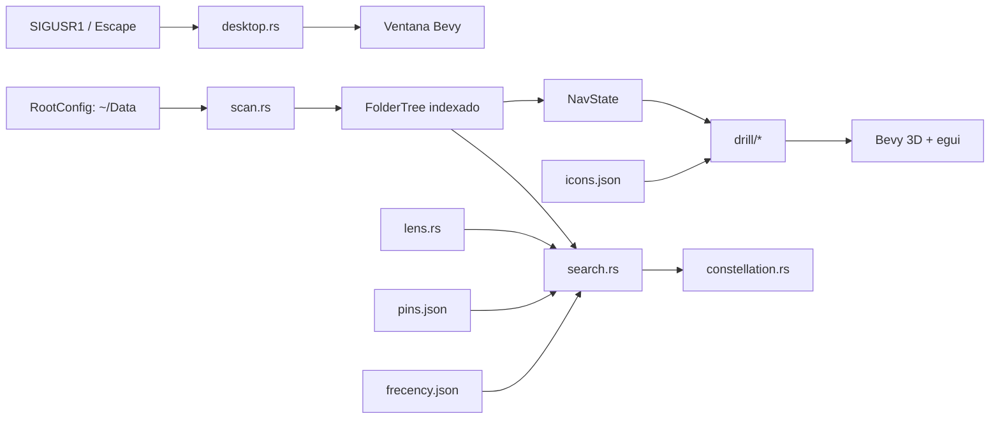

<h1 align="center">Borjes</h1>

<p align="center"><strong>Navegación visual de carpetas para Linux.</strong><br/>Rust · Bevy · escritorio</p>

> Proyecto en desarrollo. El alcance y la validación de cada funcionalidad se detallan a continuación.


Borjes es una aplicación de escritorio nativa para Linux, escrita en Rust, que permite navegar un árbol local de carpetas mediante un overlay 3D invocable por atajo. Está orientada a estructuras personales de conocimiento y trabajo donde llegar a carpetas profundas con un explorador tradicional genera fricción.

La experiencia activa usa navegación radial por nivel: la carpeta actual aparece como hub central, sus subcarpetas se distribuyen alrededor y el padre se presenta como nodo de retorno. El proceso arranca oculto y se muestra u oculta mediante `SIGUSR1`.

## Estado del producto

**Versión del crate:** `0.1.0`  
**Plataforma soportada y probada:** Linux desktop, principalmente KDE Plasma sobre X11.  
**Distribución:** actualmente se compila desde el código fuente; todavía no existe AppImage, DEB, RPM ni paquete firmado mantenido por el repositorio.

### Capacidades activas

- Overlay fullscreen sin decoraciones y siempre arriba.
- Arranque oculto y alternancia mediante `SIGUSR1`.
- Raíz predeterminada `~/Data`.
- Escaneo recursivo con exclusión de directorios de ruido.
- Navegación radial por nivel.
- Entrada por click o hover sostenido y retorno con `Backspace`.
- Breadcrumb de la ubicación actual.
- Búsqueda global sin acentos sobre el árbol indexado.
- Resultados visualizados como constelación y abiertos con `Enter`.
- Ranking por frecency para priorizar carpetas utilizadas recientemente.
- Lentes temáticas configurables, invocables con `@nombre`.
- Pins persistentes y accesos rápidos con `Alt+1` a `Alt+9`.
- Personalización visual por carpeta mediante iconos incluidos, emoji, PNG o GLB/GLTF.
- Persistencia local XDG para pins, iconos, lentes y frecency.
- Render de bajo consumo cuando la ventana está oculta.

### Límites conocidos

- La raíz activa sigue inicializándose desde `~/Data`; el editor de raíz existente en `ui.rs` pertenece al flujo heredado y no está conectado al loop principal.
- La integración de escritorio está documentada para KDE y requiere configuración manual por usuario.
- El mecanismo de mostrar/ocultar depende de señales Unix y no es portable a Windows o macOS.
- El comportamiento sobre Wayland no tiene la misma aceptación que KDE/X11; foco, always-on-top y atajos pueden variar por compositor.
- `frecency.json` y `lenses.json` todavía usan el directorio heredado `datatree-rs`, mientras que pins e iconos usan `borjes`.
- No hay CI versionado en el repositorio ni artefactos binarios publicados.

El estado detallado y los gates pendientes se mantienen en [`docs/RELEASE_STATUS.md`](docs/RELEASE_STATUS.md).

## Uso rápido

### 1. Preparar el entorno

Se necesita:

- Rust estable y Cargo.
- Toolchain C/C++ y `pkg-config`.
- Dependencias nativas requeridas por Bevy para ventana, audio e input en Linux.
- Una sesión gráfica Linux.
- Una carpeta `~/Data` para usar la configuración predeterminada.

La guía completa está en [`docs/INSTALLATION.md`](docs/INSTALLATION.md).

### 2. Verificar y compilar

```bash
cargo fmt --check
cargo check
cargo test
cargo build --release
```

### 3. Ejecutar

```bash
./target/release/borjes
```

La aplicación inicia oculta. Para mostrarla u ocultarla:

```bash
pkill -USR1 -x borjes
```

Para detener el proceso:

```bash
pkill -x borjes
```

Para uso diario conviene configurar autostart y un atajo global. Ver [`docs/desktop-setup.md`](docs/desktop-setup.md).

## Controles

| Acción | Control |
|---|---|
| Mostrar u ocultar | señal `SIGUSR1` desde el atajo global |
| Buscar | escribir al abrir el overlay |
| Elegir resultado | click, `Enter`, `Tab` o flechas |
| Limpiar búsqueda | `Esc` con una consulta activa |
| Ocultar overlay | `Esc` con la búsqueda vacía |
| Entrar a una subcarpeta | click o hover sostenido sobre el nodo |
| Subir al padre | nodo superior o `Backspace` |
| Abrir carpeta actual | `Enter` con búsqueda vacía |
| Personalizar o fijar | click derecho sobre una carpeta |
| Usar pin rápido | click en el chip o `Alt+1` a `Alt+9` |
| Activar lente | chip temático o consulta `@nombre` |

## Arquitectura resumida



La aplicación conserva módulos del enfoque anterior de grafo global, pero el flujo productivo actual es el drill-down por nivel. La separación entre código activo, reutilizado y heredado está detallada en [`docs/ARCHITECTURE.md`](docs/ARCHITECTURE.md).

## Estructura principal

```text
src/
├── main.rs            composition root de Bevy y sistemas activos
├── desktop.rs         señal, visibilidad, foco y always-on-top
├── scan.rs            recorrido y filtrado del filesystem
├── nav.rs             árbol indexado y navegación
├── drill/             experiencia radial activa
├── search.rs          búsqueda global, constelaciones y pins rápidos
├── constellation.rs   presentación de resultados globales
├── lens.rs            temas configurables
├── frecency.rs        ranking por uso reciente
├── icons.rs           overrides visuales persistentes
├── pins.rs            persistencia de accesos rápidos
├── root.rs            raíz predeterminada y reescaneo
├── layout.rs          layout force-directed heredado
├── render.rs          render global heredado y assets reutilizados
└── ui.rs              panel global heredado; solo una parte sigue registrada

docs/
├── README.md
├── ARCHITECTURE.md
├── INSTALLATION.md
├── CONFIGURATION.md
├── TESTING.md
├── RELEASE_STATUS.md
└── desktop-setup.md
```

## Persistencia local

Borjes no usa una base de datos. Mantiene archivos JSON en el directorio de configuración del usuario.

| Dato | Ruta actual |
|---|---|
| Pins | `$XDG_CONFIG_HOME/borjes/pins.json` o `~/.config/borjes/pins.json` |
| Iconos | `$XDG_CONFIG_HOME/borjes/icons.json` o `~/.config/borjes/icons.json` |
| Frecency | `$XDG_CONFIG_HOME/datatree-rs/frecency.json` o `~/.config/datatree-rs/frecency.json` |
| Lentes | `$XDG_CONFIG_HOME/datatree-rs/lenses.json` o `~/.config/datatree-rs/lenses.json` |
| Assets externos | `~/.config/borjes/assets/` cuando se usan rutas de usuario |

No se debe asumir que esos archivos son intercambiables entre equipos: pins, frecency e iconos pueden contener rutas absolutas.

La referencia completa está en [`docs/CONFIGURATION.md`](docs/CONFIGURATION.md).

## Validación

```bash
cargo fmt --check
cargo check
cargo test
cargo clippy --all-targets --all-features -- -D warnings
cargo build --release
```

Las pruebas automáticas cubren lógica de escaneo, navegación, búsqueda, layout, persistencia, iconos, lentes y frecency. La interacción real con KWin, señales, GPU, foco y apertura de carpetas requiere aceptación manual en escritorio. Ver [`docs/TESTING.md`](docs/TESTING.md).

## Documentación

- [Índice documental](docs/README.md)
- [Arquitectura implementada](docs/ARCHITECTURE.md)
- [Instalación y compilación](docs/INSTALLATION.md)
- [Configuración y persistencia](docs/CONFIGURATION.md)
- [Integración de escritorio](docs/desktop-setup.md)
- [Testing y aceptación](docs/TESTING.md)
- [Estado de release](docs/RELEASE_STATUS.md)

## Licencia

El repositorio no contiene actualmente un archivo `LICENSE`. Antes de distribuir binarios o aceptar contribuciones externas se debe definir explícitamente la licencia del código propio y revisar las licencias de dependencias y assets.