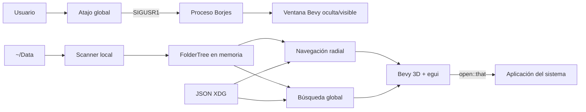
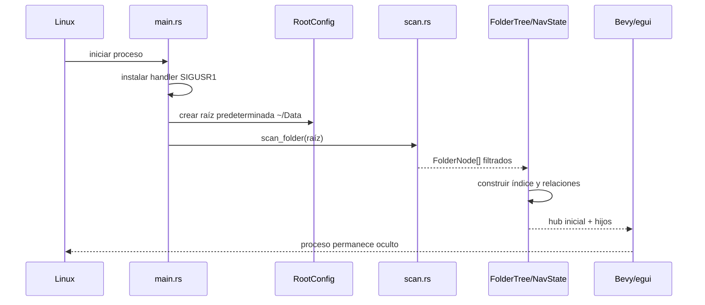
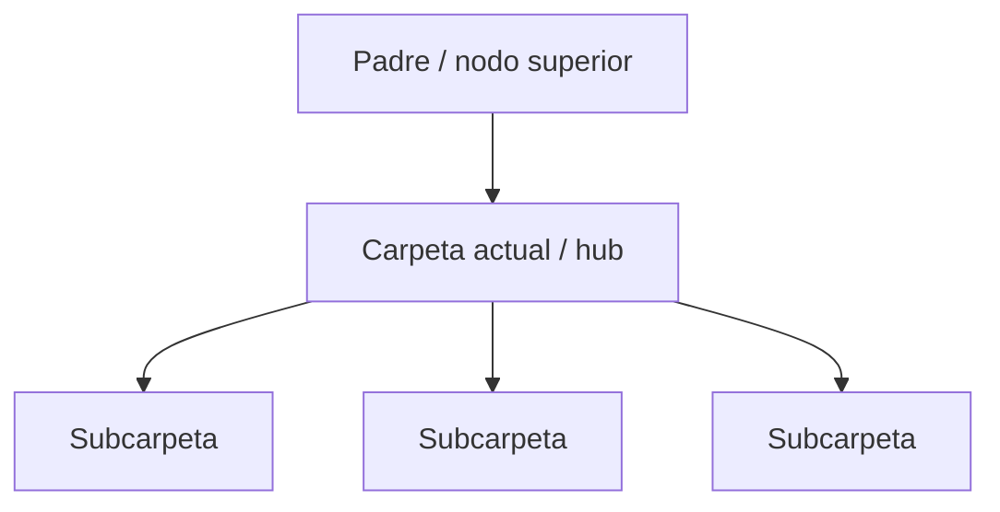

# Arquitectura implementada

## 1. Contexto

Borjes es una aplicación local y monoproceso. No tiene backend, servicios remotos ni base de datos. El proceso Bevy escanea una raíz del filesystem, construye un árbol en memoria y presenta una vista 3D navegable. Las preferencias se guardan en archivos JSON del usuario.

## 2. Composition root

`src/main.rs` construye la aplicación y registra:

- plugins de Bevy, egui, picking y cámara;
- ventana borderless fullscreen inicialmente oculta;
- asset root absoluto basado en `CARGO_MANIFEST_DIR`;
- recursos de árbol, navegación, búsqueda, iconos, pins, frecency y lentes;
- sistemas activos de overlay, búsqueda, drill-down y render;
- modo continuo cuando hay foco y modo reactivo de bajo consumo cuando no lo hay.

El handler de `SIGUSR1` se instala antes de inicializar Bevy para evitar que una señal temprana termine el proceso.

## 3. Flujo de inicio

Si la raíz no existe o no contiene carpetas válidas, `RootConfig.error` registra el motivo. El proceso no entra en pánico por una raíz faltante.

## 4. Overlay de escritorio

`desktop.rs` mantiene un `AtomicBool` global. El handler de señal solo cambia ese valor, operación segura dentro de un signal handler. El sistema Bevy consume la solicitud y alterna `Window.visible`.

Sobre KDE/X11 se vuelve a solicitar foco y nivel always-on-top durante varios frames porque KWin puede retirar esas propiedades al ocultar y volver a mapear una ventana.

Esta lógica explica por qué la compatibilidad principal es Linux/X11 y por qué Wayland necesita aceptación independiente por compositor.

## 5. Modelo de navegación

`scan.rs` recorre el filesystem y produce nodos con:

- ruta absoluta;
- nombre;
- relación padre/hijo;
- profundidad;
- cantidad de hijos;
- indicador de symlink.

`nav.rs` convierte esos nodos en `FolderTree`, con índices para navegación y búsqueda. `drill/` mantiene `NavState` y renderiza solamente el nivel actual, no el árbol completo.

El drill-down reduce el ruido visual y evita mantener miles de entidades visibles al mismo tiempo, aunque el árbol completo permanezca indexado en memoria.

## 6. Búsqueda, constelaciones y frecency

`search.rs` usa nombres normalizados sin acentos. Los resultados se ordenan por:

1. coincidencia al comienzo del nombre;
2. coincidencia en límite de palabra;
3. coincidencia como substring;
4. frecency;
5. profundidad y nombre como desempate.

Los resultados se muestran mediante `constellation.rs`. Elegir uno abre la carpeta con `open::that`, actualiza la frecency y oculta el overlay.

La frecency aplica decaimiento temporal con vida media de catorce días. No es telemetría remota: se guarda localmente en JSON.

## 7. Lentes

`lens.rs` define grupos temáticos con:

- nombre;
- palabras clave;
- color hexadecimal.

Una búsqueda `@nombre` o un chip de lente crea una constelación con carpetas coincidentes. Si una carpeta padre y una descendiente coinciden, la descendiente se elimina para evitar resultados redundantes bajo una rama ya representada.

El editor de lentes desde UI no está implementado. El archivo se modifica manualmente.

## 8. Pins

`pins.rs` persiste rutas de carpetas. El menú contextual activo en `drill/overlay.rs` permite agregar o quitar pins. `search.rs` presenta hasta nueve accesos rápidos y permite activarlos con `Alt+1` a `Alt+9`.

Los pins contienen rutas absolutas; mover la raíz o sincronizar el archivo a otro equipo puede producir referencias inválidas.

## 9. Personalización visual

`icons.rs` permite resolver una representación por:

1. ruta absoluta;
2. nombre de carpeta;
3. esfera predeterminada.

Los tipos admitidos son:

- esfera;
- icono PNG incluido;
- emoji;
- PNG externo;
- modelo GLB/GLTF.

El menú contextual guarda los cambios en `icons.json`. La escala se limita al rango seguro `0.2..=4.0` y puede habilitar halo.

## 10. Módulos activos, reutilizados y heredados

| Módulo | Estado | Uso actual |
|---|---|---|
| `main.rs` | Activo | composition root y sistemas registrados |
| `desktop.rs` | Activo | visibilidad, foco y always-on-top |
| `scan.rs` | Activo | escaneo y filtrado |
| `nav.rs` | Activo | árbol e índice |
| `drill/` | Activo | navegación y render radial |
| `search.rs` | Activo | búsqueda, apertura y pins rápidos |
| `constellation.rs` | Activo | resultados globales |
| `lens.rs` | Activo | lentes temáticas |
| `frecency.rs` | Activo | ranking por uso |
| `icons.rs` | Activo | personalización visual |
| `pins.rs` | Activo | persistencia de pins |
| `root.rs` | Activo/parcial | raíz predeterminada; re-root UI no conectado |
| `ui.rs` | Mixto | normalización y animación activas; panel global heredado no registrado |
| `render.rs` | Mixto | assets reutilizados y camino de grafo global heredado |
| `layout.rs` | Heredado | force-directed global no usado por el flujo principal |
| `interaction.rs` | Mixto | tipos/utilidades compartidos y partes del flujo anterior |

## 11. Límites arquitectónicos

- La raíz no se recibe por CLI ni se persiste como preferencia activa.
- La señal `SIGUSR1` acopla el producto a Unix.
- La ruta absoluta de assets se incorpora durante compilación, por lo que mover solo el binario sin assets puede romper recursos incluidos.
- La aplicación no implementa sandbox: puede leer nombres y estructura de toda la raíz que el usuario le permita recorrer.
- La apertura de carpetas se delega a la asociación del sistema.
- No existe todavía una frontera formal entre librería reusable y binario; toda la lógica vive en el crate de aplicación.

## 12. Dirección recomendada

Antes de declarar una versión distribuible:

1. definir configuración de raíz por CLI o archivo XDG;
2. unificar rutas heredadas `datatree-rs` bajo `borjes` con migración compatible;
3. separar assets instalables del path de compilación;
4. retirar o aislar módulos heredados;
5. agregar CI y empaquetado reproducible;
6. validar KDE/X11, KDE/Wayland y al menos otro escritorio de forma explícita.