# 04 — Diagramas UML

## Propósito

Yo uso UML para representar Borjes como producto, aplicación nativa y sistema ECS. Mermaid no implementa toda la notación UML estricta, por lo que adapto algunas vistas manteniendo su intención.

## Cobertura UML 2

| Tipo | Cobertura | Aplicación |
|---|---|---|
| casos de uso | incluida | navegación y personalización |
| clases | incluida | modelos y servicios principales |
| objetos | incluida | escena concreta |
| componentes | incluida | módulos ejecutables |
| paquetes | incluida | dependencias del código |
| estructura compuesta | incluida | interior de la escena/overlay |
| despliegue | incluida | binario, desktop y filesystem |
| actividad | incluida | navegación |
| estados | incluida | ciclo del overlay |
| secuencia | incluida | apertura y navegación |
| comunicación | incluida | mensajes entre sistemas ECS |
| visión general de interacción | incluida | flujo búsqueda/navegación |
| temporal | incluida | apertura/render/reposo |
| perfil | incluida | estereotipos de módulos |

## 1. Casos de uso

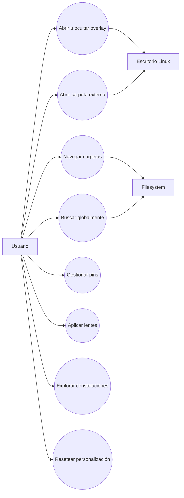

## 2. Clases/modelos

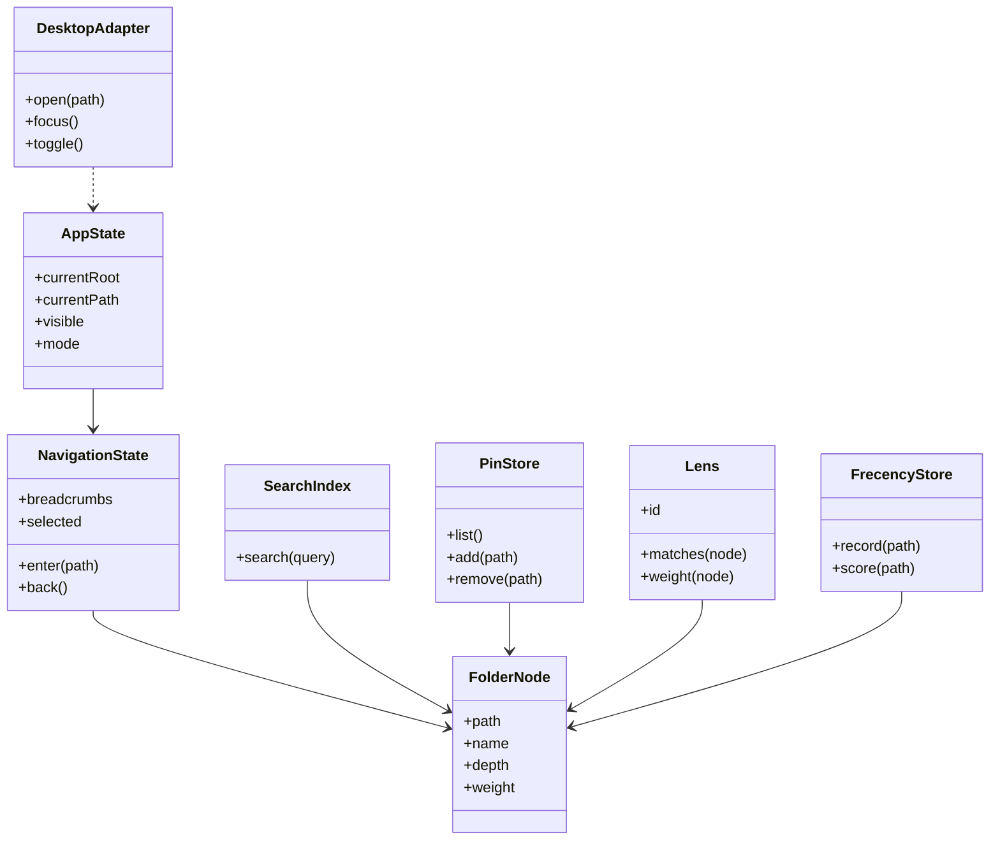

## 3. Objetos en una escena

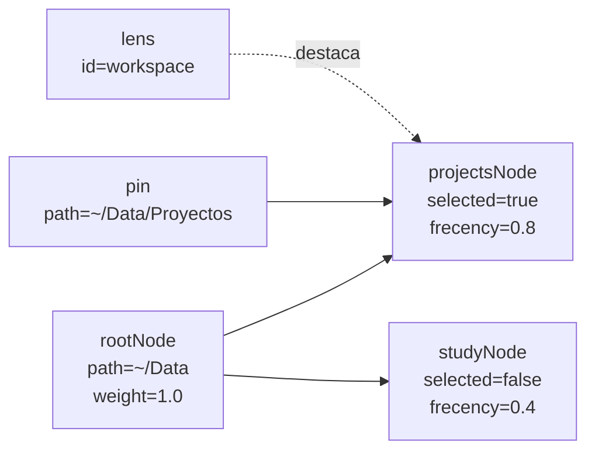

## 4. Componentes

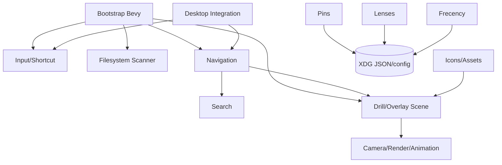

## 5. Paquetes

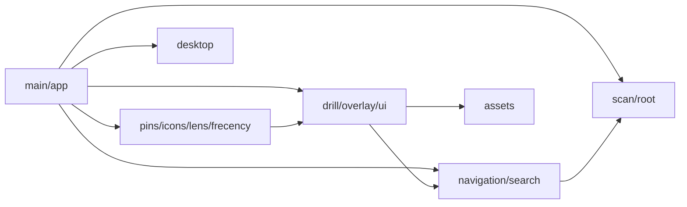

## 6. Estructura compuesta del overlay

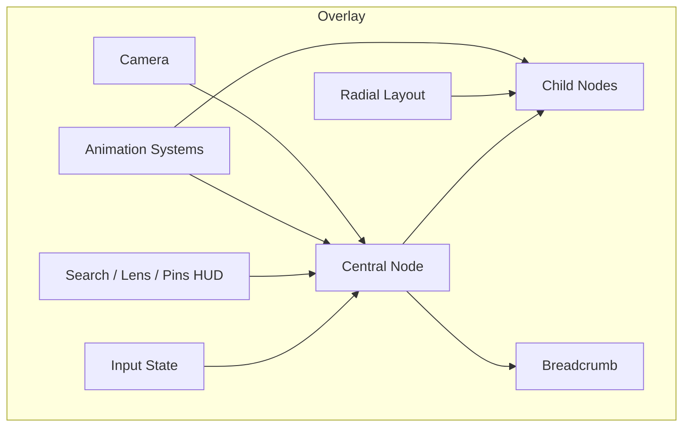

## 7. Actividad de navegación

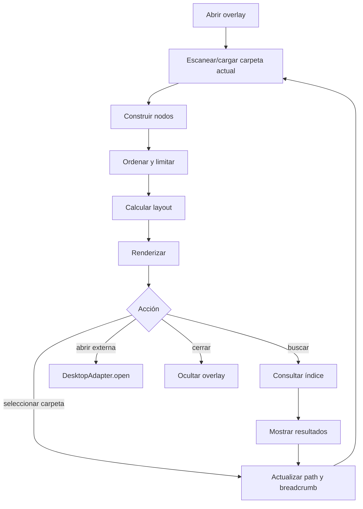

## 8. Máquina de estados del overlay

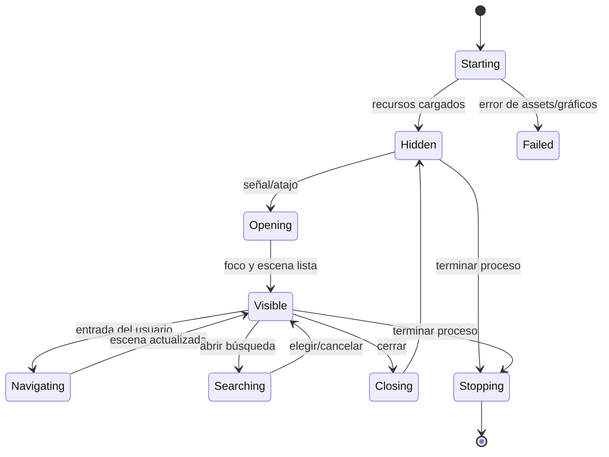

## 9. Secuencia de apertura

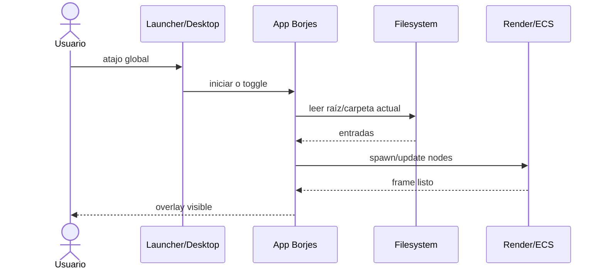

## 10. Secuencia de búsqueda

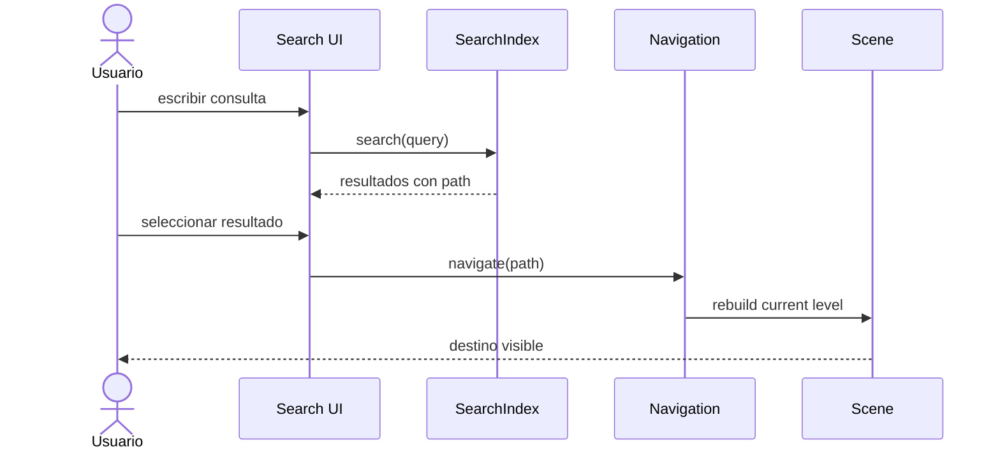

## 11. Comunicación ECS

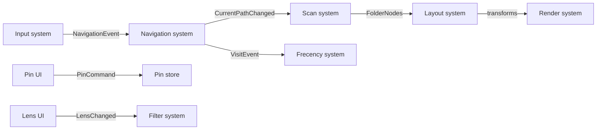

## 12. Visión general de interacción

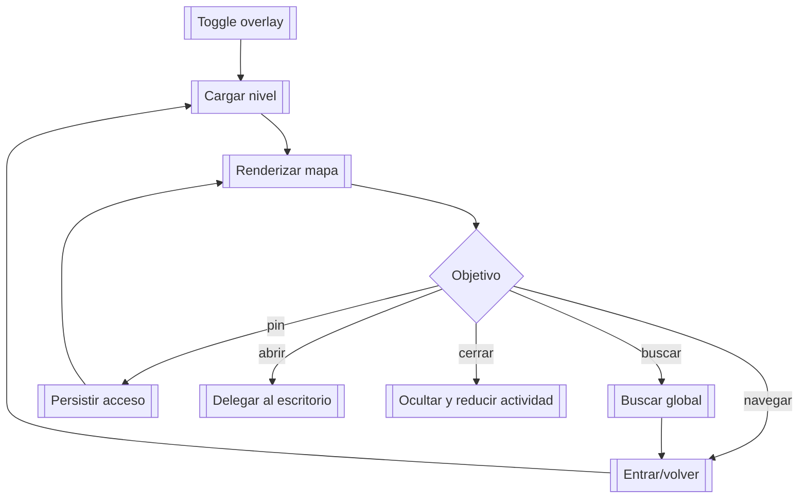

## 13. Temporal: visible y oculto

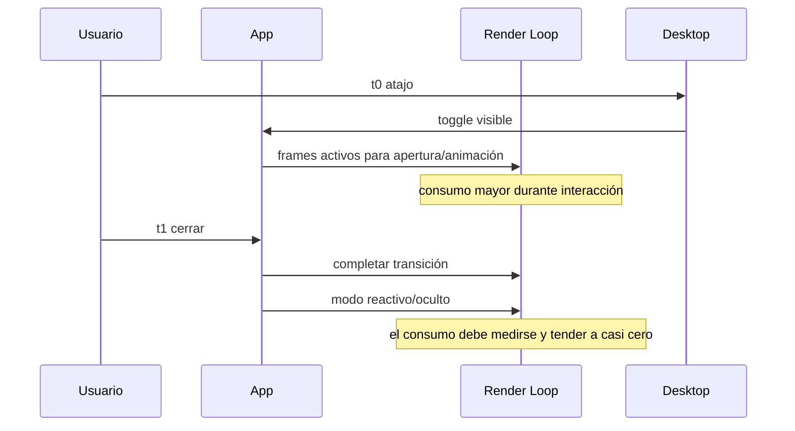

La implementación exacta de wake-up/polling depende de la rama fusionada; yo no documento como hecho un cambio que solo vive en otro PR.

## 14. Despliegue

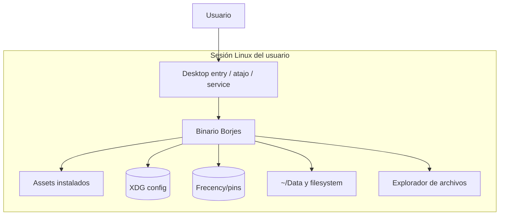

## 15. Perfil UML de módulos

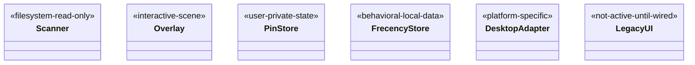

## Regla de mantenimiento

Yo actualizo estas vistas cuando cambia un módulo activo, evento ECS, estado, ruta XDG, dependencia de assets o integración del escritorio. El diagrama debe distinguir `main` de funciones que solo existen en PRs abiertos.